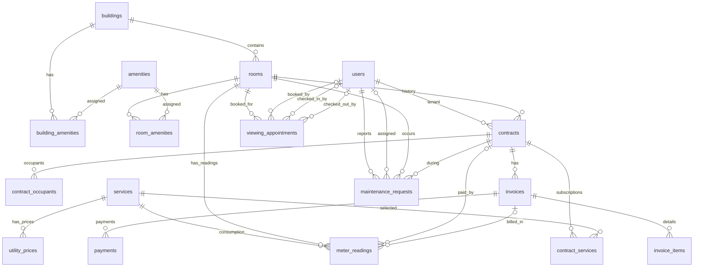

# 09 — DATABASE DESIGN — MINI APARTMENT MANAGEMENT

> **Bổ sung27/10, DB-D64:** thiết kế mở rộng thành **22 bảng nghiệp vụ** bằng meter_reading_submissions (§3.22), chỉ chuẩn bị/kiểm thử DB test. Không phê duyệt migration dev. Các mốc21 bảng bên dưới là baseline lịch sử; U2 không tự phê duyệt phần thanh lý hoặc U3. Alias ảnh mới meter_reading_submission, collection meter_reading_photo, disk private; chưa có endpoint upload/download trong lượt chuẩn bị.

> **Cập nhật đã duyệt 22/10/2026 — v1.6, DB-D51:** email đăng ký là tùy chọn; schema mục 3.1 và checklist đã cập nhật. Thay đổi được triển khai bằng migration ALTER mới, không sửa migrations đã commit; **đã áp dụng riêng trên DB dev theo phê duyệt bước 3.5**, DB plan §16. Các ghi chép baseline 14/10 bên dưới là lịch sử thiết kế.

| Thuộc tính | Giá trị |
|---|---|
| Trạng thái | Thiết kế đã duyệt; tiến độ triển khai/kiểm thử từng đợt ở `DATABASE_IMPLEMENTATION_PLAN.md`. DB-D51 đã kiểm thử DB test và áp dụng riêng dev (batch 3); Nhóm 2–3 vẫn chỉ test, xem DB plan §16 |
| Phiên bản | **1.7** — 27/10/2026: DB-D64/U2 thêm bảng22, chỉ chuẩn bị/test; giữ DB-D51 và các quyết định đã chốt. Cấu trúc hợp đồng/thanh lý còn mở ở `DATABASE_IMPLEMENTATION_PLAN.md` §14. Lịch sử: §10 |
| Phạm vi | **22 bảng chính** theo DB-D64, 5 actor; một chủ nhà quản lý nhiều tòa nhà, không multi-tenant |
| Nguồn | `02_SYSTEM_DISCOVERY.md` v0.10 (04/10/2026); quyết định bổ sung 13–14/10/2026 trong `DB_DECISIONS_20261014.md` |
| Ưu tiên khi xung đột | (1) quyết định mới trong `DB_DECISIONS_20261014.md`; (2) bản thiết kế này; (3) `02_SYSTEM_DISCOVERY.md` v0.10 và các tài liệu `03`–`08` ở các phần không xung đột |

> **Phạm vi phê duyệt:** Người dùng đã đồng ý để AI lựa chọn các chi tiết kỹ thuật hợp lý và chuẩn bị tài liệu; đây là **đặc tả thiết kế** chứ **không phải lệnh cho Claude tự chạy migration**. Trong repo, cần đọc `AGENTS.md`/`CLAUDE.md` thực tế, đồng bộ tài liệu, sau đó xin phép người dùng trước khi tạo/chạy migrations nghiệp vụ.

## 1. Quy ước bắt buộc

**Ghi đè mới28/10 (DB-D65/66/67/68):** periodic có hợp đồng chống trùng hợp đồng/dịch vụ/kỳ; periodic phòng trống chống trùng phòng/dịch vụ/kỳ; final chống trùng hợp đồng/lần thanh lý/dịch vụ, giữ enum hiện có và lịch sử. Không còn giới hạn một lần thanh lý/phòng/tháng. M14 hiện tại vẫn UNIQUE cũ; phải dùng migration ALTER mới và kiểm tra nâng cấp/rollback trên DB test, không migration dev. Thanh lý thêm overdue_return (ghi chú bắt buộc), same_day không phí trước hạn, chủ nhà chấm dứt ngoài MVP; P6/P7/P8/P11 đã duyệt theo DB plan§14.4. Các ghi chú chưa chốt/giới hạn cũ ở từ điển bên dưới phải đọc theo cập nhật này; chưa coi schema/API đã đổi.

1. **Tiền:** lưu **số nguyên đồng Việt Nam (VND)**; tiền không âm `BIGINT UNSIGNED`, khoản mục có thể âm (`invoice_items.amount`) dùng **`BIGINT` có dấu**. Đơn giá `BIGINT UNSIGNED`. Không lưu giá tiền bằng float/DOUBLE; không chuyển lượng có phần thập phân sang float để tính toán. Dùng decimal arithmetic (BCMath hoặc thư viện decimal đã được duyệt) và **ROUND_HALF_UP đến đồng** ở **từng dòng hóa đơn / từng chỉ số tiền**; `total_amount = SUM(invoice_items.amount)` số nguyên. `invoice_items.unit_price` không âm kể cả khi loại dòng `discount`; dấu âm được phản ánh ở `amount`.
2. **Lượng:** chỉ số điện/nước và tiêu thụ `DECIMAL(10,2)`; số lượng đăng ký `DECIMAL(10,2)`, nhưng `per_person` và `per_unit` là số nguyên dương theo FormRequest; `per_room` và `metered` có `quantity = 1`. `area` dùng `DECIMAL(8,2)`.
3. **Thời gian:** timestamp là **thời điểm UTC** trong DB và qua API dạng ISO-8601 UTC, FE hiển thị `Asia/Ho_Chi_Minh`; `DATE` là **ngày lịch Việt Nam** (không tự chuyển múi giờ). `period` luôn là ngày `01` của tháng; với `meter_readings`, `period` là **tháng tiêu thụ**, không nhất thiết trùng tháng của `reading_date` (DB-D15). Backend tính kỳ, ngày đến hạn và số ngày tháng theo múi giờ Việt Nam; cấu hình timezone của việc lưu và sinh timestamp cần thống nhất ở Laravel/MySQL/Docker.
4. **Khóa, trạng thái:** PK nghiệp vụ `BIGINT UNSIGNED AUTO_INCREMENT`, Laravel `id()` / `foreignId()`. Trạng thái `VARCHAR` + PHP Enum, **không dùng MySQL ENUM**. `notifications.id` dùng UUID; `sessions.id` là chuỗi theo Laravel.
5. **Dữ liệu:** FK `RESTRICT`/`NO ACTION` đối với dữ liệu lịch sử; cascade chỉ cho bảng pivot sở hữu hoàn toàn và **khi xóa cha được phép**. Không xóa cứng giao dịch tài chính/hợp đồng đã hoạt động; giữ snapshot giao dịch cũ khi danh mục/giá thay đổi.
6. **Quyền:** 5 vai trò kỹ thuật `user`, `resident`, `admin`, `technician`, `guard` trong `users.role`. Khách không đăng nhập không có hàng trong `users`. Phân quyền phải được kiểm tra ở backend Policy + query scope, không tin client.
7. **Mã nghiệp vụ:** `HD-YYYY-NNNN`, `INV-YYYYMM-NNNN`, `RCP-YYYYMM-NNNN`, `MR-YYYYMM-NNNN`, `APT-YYYYMM-NNNN`: `NNNN` là **ID tự tăng đệm tối thiểu 4 chữ số, không reset theo tháng/năm** (ID ≥ 10000 thì dài hơn). Cột mã **NULL được** trước khi sinh, gán trong **cùng transaction** với thao tác sinh mã, unique index; không dùng MAX()+1. Hợp đồng sinh mã khi **kích hoạt**, hóa đơn khi **phát hành**, biên nhận khi **xác nhận thanh toán**, yêu cầu sửa chữa/lịch hẹn ngay khi tạo (DB-D13).
8. **Quy ước tên và tính toán:** `snake_case` cho bảng/cột; `created_at`, `updated_at` cho các bảng nghiệp vụ trừ pivot thuần và `sessions` theo mặc định Laravel. `billing_type` của `services` không quyết định nghĩa vụ thanh toán nếu chưa đăng ký ở `contract_services`.

## 2. Danh sách 22 bảng sau DB-D64

| STT | Bảng | Nhóm |
|---:|---|---|
| 1 | `users` | tài khoản |
| 2 | `buildings` | nhà / phòng |
| 3 | `rooms` | nhà / phòng |
| 4 | `amenities` | tiện nghi |
| 5 | `building_amenities` | tiện nghi **cấp tòa nhà — mới** |
| 6 | `room_amenities` | tiện nghi cấp phòng |
| 7 | `attachments` | file đa hình |
| 8 | `contracts` | hợp đồng |
| 9 | `contract_occupants` | người ở cùng |
| 10 | `services` | danh mục dịch vụ |
| 11 | `contract_services` | dịch vụ theo hợp đồng |
| 12 | `utility_prices` | lịch sử giá điện nước |
| 13 | `meter_readings` | chỉ số điện nước |
| 14 | `invoices` | hóa đơn |
| 15 | `invoice_items` | dòng hóa đơn |
| 16 | `payments` | giao dịch thanh toán |
| 17 | `maintenance_requests` | sửa chữa |
| 18 | `viewing_appointments` | lịch xem phòng |
| 19 | `notifications` | thông báo Laravel |
| 20 | `settings` | cấu hình nghiệp vụ |
| 21 | `sessions` | phiên đăng nhập Sanctum SPA |
| 22 | `meter_reading_submissions` | yêu cầu chỉ số chờ duyệt, tách khỏi chỉ số tính tiền |

Các bảng hạ tầng khác do Laravel cần (`migrations`, `cache`, `jobs` ... tùy config) **không tính vào 22**. Các bảng SHOULD/FUTURE (`contact_requests`, `activity_logs`, `maintenance_status_logs`, `personal_access_tokens`) không tự thêm vào đợt triển khai hiện tại.

## 3. Từ điển bảng và cột vật lý

**Viết tắt:** `PK` khóa chính; `FK` khóa ngoại; `NN` NOT NULL; `UQ` unique; `NULL` nullable; `DEF` default. Các bảng có hậu tố `(timestamps)` gồm `created_at` và `updated_at`, đều là timestamp UTC. `BIGINT UNSIGNED` cho ID/MONEY không âm, `BIGINT SIGNED` chỉ cho số tiền dòng âm. MVP **không thêm CHECK constraint thủ công** (DB-D20): ràng buộc giá trị (>0, khoảng ngày, chỉ số…) kiểm tra tại FormRequest/Service, cùng với FK, UNIQUE, UNSIGNED của MySQL.

### 3.1 `users` (timestamps)

| Cột | MySQL | Ràng buộc |
|---|---|---|
| `id` | BIGINT UNSIGNED | PK |
| `full_name` | VARCHAR(120) | NN |
| `email` | VARCHAR(191) | NULL, UQ nếu có (DB-D51, duyệt 22/10/2026) |
| `phone` | VARCHAR(20) | NN, UQ |
| `password` | VARCHAR(255) | NN, hash |
| `role` | VARCHAR(20) | NN, DEF `user`; `user/resident/admin/technician/guard` |
| `status` | VARCHAR(20) | NN, DEF `active`; `active/locked` |
| `id_number` | VARCHAR(20) | NULL, UQ nếu có |
| `date_of_birth` | DATE | NULL |
| `gender` | VARCHAR(20) | NULL |
| `permanent_address` | TEXT | NULL |
| `email_verified_at` | TIMESTAMP | NULL; **giữ** cột Laravel, MVP chưa xác thực email (DB-D12) |
| `remember_token` | VARCHAR(100) | NULL, Laravel standard khi dùng |

Index `(role,status)`. Bảng `users` đã có từ migration framework: thay đổi bằng **migration ALTER mới**, không sửa migration đã chạy (DB-D21). `id_number` **ẩn khỏi serialization mặc định**, chỉ Resource dành cho Admin có quyền mới trả về (DB-D19). Người thuê đại diện là `contracts.user_id`; người ở cùng không bắt buộc có tài khoản. Không xóa tài khoản từng có hợp đồng; khóa thay vì xóa.

**Đăng ký (DB-D51 — CONFIRMED 22/10/2026):** bắt buộc `full_name`, `phone`, `password`; `email` tùy chọn. Không có email thì lưu NULL, không dùng chuỗi rỗng hoặc email giả. MySQL cho nhiều NULL trong UNIQUE email; các email có giá trị vẫn phải duy nhất. UNIQUE và NOT NULL của `phone` không đổi. Backend/React Auth đã tích hợp; Docker dev 8080 kiểm chứng tại Plan §10; Spec và phê duyệt tại [AUTHENTICATION.md](AUTHENTICATION.md).

**Migration và rollback:** `2026_10_22_100001_make_users_email_nullable` chỉ đổi nullability của `users.email`, giữ độ dài 191, UNIQUE và dữ liệu hiện có. `down()` dừng trước ALTER nếu có email NULL, không tự sửa/xóa dữ liệu. Muốn bắt buộc email trở lại cần kế hoạch thu thập email thật, backup và tạm dừng ghi tài khoản khi đổi schema. Migration này đã được duyệt/chạy riêng trên dev ở bước 3.5; không suy ra quyền chạy migrations khác.

### 3.2 `buildings` (timestamps)

| Cột | MySQL | Ràng buộc |
|---|---|---|
| `id` | BIGINT UNSIGNED | PK |
| `name` | VARCHAR(150) | NN, UQ trong phạm vi một chủ nhà |
| `address` | VARCHAR(500) | NN |
| `total_floors` | SMALLINT UNSIGNED | NN, >= 1 |
| `latitude`, `longitude` | DECIMAL(10,7), DECIMAL(10,7) | NULL; lần lượt [-90,90], [-180,180] |
| `description` | TEXT | NULL |
| `status` | VARCHAR(20) | NN, DEF `active`; `active/inactive` |

Không tự xóa nhà khi còn phòng/hợp đồng. `rooms.floor_number` phải nằm trong khoảng số tầng cho phép (mặc định 1..total_floors, nếu có tầng hầm cần thay đổi quy tắc có chủ đích).

### 3.3 `rooms` (timestamps)

| Cột | MySQL | Ràng buộc |
|---|---|---|
| `id` | BIGINT UNSIGNED | PK |
| `building_id` | BIGINT UNSIGNED | FK → `buildings.id`, NN, RESTRICT |
| `code` | VARCHAR(50) | NN, UQ cùng tòa |
| `floor_number` | SMALLINT UNSIGNED | NN |
| `area` | DECIMAL(8,2) | NN, > 0 |
| `base_price`, `deposit_amount` | BIGINT UNSIGNED | NN, >= 0 |
| `max_occupants` | SMALLINT UNSIGNED | NN, >= 1 |
| `status` | VARCHAR(20) | NN, DEF `available`; `available/occupied/maintenance/inactive` |
| `is_public` | BOOLEAN | NN, DEF false |
| `description` | TEXT | NULL |

`UNIQUE(building_id,code)`; index `(building_id,status,is_public)`. Không tự cho phòng occupied lên website để đặt lịch; khóa hợp đồng và phòng trong cùng transaction khi kích hoạt/thanh lý. `is_public` không thay thế `status`.

### 3.4 `amenities` (timestamps)

`id BIGINT UNSIGNED PK`, `name VARCHAR(120) NN UQ`, `description TEXT NULL`, `deleted_at TIMESTAMP NULL` (soft delete danh mục). Tiện nghi là tính năng/cơ sở vật chất, không tự sinh tiền thu.

### 3.5 `building_amenities` (pivot mới)

`building_id BIGINT UNSIGNED NN FK → buildings.id`, `amenity_id BIGINT UNSIGNED NN FK → amenities.id`; **composite PK (building_id,amenity_id)**. Index `(amenity_id)` phục vụ tra cứu ngược. Không có `id` riêng, không bắt buộc timestamps. FK CASCADE với pivot nếu cha được phép xóa vật lý, còn FK của hợp đồng/phòng bảo vệ lịch sử. Tòa nhà có Thang máy/Camera/Bãi xe; phòng hiển thị hợp nhất `building_amenities ∪ room_amenities` theo amenity ID.

### 3.6 `room_amenities` (pivot)

`room_id BIGINT UNSIGNED NN FK → rooms.id`, `amenity_id BIGINT UNSIGNED NN FK → amenities.id`; **composite PK (room_id,amenity_id)**, index `(amenity_id)`. Chỉ lưu tiện nghi riêng của phòng; **không sao chép tiện nghi tòa nhà xuống mỗi phòng**.

### 3.7 `attachments` (timestamps)

| Cột | MySQL | Ràng buộc |
|---|---|---|
| `id` | BIGINT UNSIGNED | PK |
| `attachable_type` | VARCHAR(100) | NN, morphMap cố định `room/maintenance_request/payment/contract`; U2 thêm `meter_reading_submission` |
| `attachable_id` | BIGINT UNSIGNED | NN |
| `collection` | VARCHAR(50) | NN, `room_gallery/maintenance_photo/payment_proof/inspection_photo/damage_photo/waiver_evidence`; U2 thêm `meter_reading_photo` |
| `disk` | VARCHAR(20) | NN, `public/private` |
| `path` | VARCHAR(500) | NN |
| `original_name` | VARCHAR(255) | NN |
| `mime_type` | VARCHAR(100) | NN |
| `size_bytes` | BIGINT UNSIGNED | NN, > 0 |
| `is_cover` | BOOLEAN | NN, DEF false |
| `sort_order` | INT UNSIGNED | NN, DEF 0 |

Index `(attachable_type,attachable_id,collection)`. Polymorphic không có FK SQL đa bảng. Ảnh phòng public; ảnh sửa chữa/minh chứng thanh toán/kiểm kê tài sản/bồi thường/miễn phí private và truy cập theo Policy cha; MIME thật, ảnh jpg/png/webp, PDF khi feature tài liệu cho phép, tối đa 5 MB/tệp. Payment do cư dân gửi kèm **đúng 1** `payment_proof` (kiểm tra ở Service). Sự cố/ảnh kiểm kê tối đa 5 ảnh mỗi lần gửi; mỗi dòng damage phải gắn ít nhất một ảnh. Việc xóa file vật lý phải phối hợp với transaction; không tạo đường dẫn public cho file riêng tư.

### 3.8 `contracts` (timestamps + `deleted_at` cho draft)

| Cột | MySQL | Ràng buộc |
|---|---|---|
| `id` | BIGINT UNSIGNED | PK |
| `contract_number` | VARCHAR(30) | NULL đến khi kích hoạt, UQ; sinh khi active (DB-D13) |
| `room_id` | BIGINT UNSIGNED | FK → rooms.id, NN, RESTRICT |
| `user_id` | BIGINT UNSIGNED | FK → users.id, NN, RESTRICT |
| `status` | VARCHAR(20) | NN, DEF `draft`; `draft/active/terminated` (`expired` chỉ khi gia hạn SHOULD) |
| `start_date`, `end_date` | DATE | NN, `end_date > start_date` (xem đề xuất P1); `end_date` là **ngày cuối cùng được ở, tính cả ngày đó** (inclusive); trả phòng đúng hạn ⇒ `actual_end_date = end_date + 1` (DB-D43, thay DB-D39) |
| `activated_at` | TIMESTAMP | NULL |
| `actual_end_date` | DATE | NULL; **ngày bàn giao thực tế**, là **mốc loại trừ** khi tính ngày thuê: hợp đồng tính tiền đến hết `actual_end_date − 1` (DB-D32) |
| `monthly_rent` | BIGINT UNSIGNED | NN, >= 0 |
| `early_termination_fee_type` | VARCHAR(20) | NULL khi chưa thỏa thuận trong draft; `none/fixed/rent_multiple`, không default; snapshot bất biến sau kích hoạt (DB-D61) |
| `early_termination_fee_amount` | BIGINT UNSIGNED | NULL, chỉ có giá trị với `fixed`; không tự mặc định phí |
| `early_termination_fee_multiplier` | DECIMAL(5,2) | NULL, chỉ với `rent_multiple`, >0; tính qua Money, HALF_UP |
| `early_termination_waiver_conditions` | JSON | NULL hoặc mảng snapshot `[{code,description}]`; không đọc lại cấu hình để đổi hợp đồng cũ |
| `early_termination_waiver_code` | VARCHAR(50) | NULL; mã được chọn khi miễn, phải thuộc snapshot điều kiện |
| `early_termination_waived_by` | BIGINT UNSIGNED | NULL, FK → users.id, RESTRICT; server xác định Admin xác nhận |
| `early_termination_waived_at` | TIMESTAMP | NULL; thời điểm Admin xác nhận miễn toàn bộ |
| `early_termination_waiver_note` | TEXT | NULL; căn cứ bắt buộc khi miễn; tệp theo P8 còn chờ duyệt |
| `occupant_count` | SMALLINT UNSIGNED | NN, >= 1, <= rooms.max_occupants |
| `initial_electricity_reading`, `initial_water_reading` | DECIMAL(10,2) | NN khi active; có thể NULL khi draft chưa hoàn chỉnh |
| `meter_gap_reason` | TEXT | NULL; bắt buộc khi chỉ số đầu cao hơn chỉ số chốt gần nhất (DB-D40) |
| `meter_gap_confirmed_by` | BIGINT UNSIGNED | NULL, FK → users.id, RESTRICT; Admin xác nhận chênh lệch; thời điểm xác nhận = `activated_at` (DB-D40) |
| `deposit_amount` | BIGINT UNSIGNED | NN, DEF 0 |
| `deposit_status` | VARCHAR(20) | NN, DEF `unpaid`; `unpaid/held/settled` (`transferred` SHOULD) |
| `deposit_paid_at` | TIMESTAMP | NULL; cọc>0 phải được xác nhận thực nhận đủ (`held` + thời điểm thu) trước kích hoạt; cọc0 không cần thu (DB-D62) |
| `deposit_deducted_amount`, `deposit_refund_amount` | BIGINT UNSIGNED | NN, DEF 0 |
| `deposit_settled_at` | TIMESTAMP | NULL |
| `inspection_result` | VARCHAR(20) | NULL; `no_damage` / `damaged` (DB-D67); bắt buộc trước khi thanh lý (DB-D49) |
| `inspected_by` | BIGINT UNSIGNED | NULL, FK → users.id, RESTRICT; chỉ Backend gán Admin đã xác thực |
| `inspected_at` | TIMESTAMP | NULL; thời điểm kiểm kê lưu UTC |
| `inspection_note` | TEXT | NULL; ghi chú tình trạng tài sản |
| `renewed_from_id` | BIGINT UNSIGNED | NULL, UQ, FK → contracts.id, RESTRICT |
| `closure_reason` | VARCHAR(50) | NULL khi chưa thanh lý; **mã phân loại** (DB-D46/D66): `on_time`, `early_termination`, `same_day`, `overdue_return` — phải nhất quán với `actual_end_date`; chủ nhà chấm dứt trước hạn ngoài MVP |
| `closed_at` | TIMESTAMP | NULL |
| `closure_note`, `note` | TEXT | NULL; `closure_note` = giải thích chi tiết, **bắt buộc** khi `closure_reason` ∈ {`early_termination`, `same_day`, `overdue_return`} (DB-D46/D66) |
| `deleted_at` | TIMESTAMP | NULL; chỉ soft-delete draft |

Index `(room_id,status,start_date)`, `(user_id,status)`, `(status,end_date)`. **Một active mỗi phòng và mỗi đại diện:** dùng generated columns có UNIQUE (xem §6) và transaction `lockForUpdate()` trên room/user/contract. `occupant_count` **gồm người đại diện**, các hàng `contract_occupants` chỉ lưu người ở cùng. Kích hoạt tự tạo đăng ký `ELECTRICITY` và `WATER`; cập nhật phòng occupied và vai trò user→resident cùng transaction. Không đổi phòng, người thuê, tiền thuê, cọc, ngày bắt đầu/kết thúc sau khi active. Gia hạn SHOULD tạo hợp đồng mới `renewed_from_id`, không sửa đè hợp đồng cũ; `expired` (status) và `transferred` (deposit_status) chỉ khai báo sẵn, MVP chưa mở chuyển trạng thái (DB-D38). **Ngày tính tiền** của hợp đồng = `[start_date, actual_end_date)`; bàn giao cùng ngày D thì ngày D chỉ thuộc hợp đồng mới (DB-D32). **Sau thanh lý** người thuê **giữ** `role = resident` để xem lịch sử; "đang thuê" suy ra từ hợp đồng `active`, thao tác cần hợp đồng active phải kiểm tra điều đó (DB-D36). Chỉ số đầu hợp đồng mới **cao hơn chỉ số chốt gần nhất** của phòng/dịch vụ chỉ được chấp nhận khi Admin xác nhận: lý do lưu `meter_gap_reason`, người xác nhận `meter_gap_confirmed_by`, thời điểm là `activated_at`; phần chênh không tính cho ai; **thấp hơn** thì chặn (DB-D31, DB-D40). Hai cột này chỉ ghi trong transaction kích hoạt, không sửa được qua form cập nhật hợp đồng thông thường. **Quá `end_date`** mà vẫn `active` thì tiếp tục tính tiền sử dụng thực tế (DB-D43). **Phân loại thanh lý** (DB-D46) suy từ ngày bàn giao: `same_day` ⇔ `actual_end_date = start_date`; `on_time` ⇔ `actual_end_date = end_date + 1`; `early_termination` ⇔ `start_date < actual_end_date ≤ end_date`; trả quá hạn chưa có mã (P3). **Nhận và trả cùng ngày** (DB-D41, DB-D45): số ngày tính tiền phòng = 0, bắt buộc `closure_note`, chốt chỉ số thực tế, đối soát cọc theo quy trình, vẫn dùng `terminated`. **Bồi thường trả trước hạn** (DB-D47): điều khoản xác định khi ký — không bồi thường / số tiền cố định / hệ số × `monthly_rent` đã snapshot — không mặc định một tháng tiền thuê; hệ thống tự tính khi thanh lý; điều khoản bất biến sau kích hoạt. **Miễn bồi thường** (DB-D48) chỉ khi đáp ứng điều kiện đã ghi trong hợp đồng, Admin xác nhận điều kiện áp dụng kèm căn cứ. **Kiểm tra tài sản** (DB-D49) bắt buộc trước thanh lý; không hư hỏng bất thường → phí tài sản 0; có hư hỏng thuộc trách nhiệm người thuê → hạng mục, lý do, số tiền có căn cứ, ảnh minh chứng; tách biệt với phí trả trước hạn. Cấu trúc lưu điều khoản, điều kiện miễn và kết quả kiểm tra: **chưa chốt** (`DATABASE_IMPLEMENTATION_PLAN.md` §14, P4–P6).

### 3.9 `contract_occupants` (timestamps)

`id BIGINT UNSIGNED PK`, `contract_id BIGINT UNSIGNED FK → contracts.id NN`, `full_name VARCHAR(120) NN`, `phone VARCHAR(20) NULL`, `relationship VARCHAR(50) NULL`. Index `(contract_id)`. Không bắt buộc tạo tài khoản; `occupant_count` vẫn có thể được quản lý độc lập khi UI cho người ở cùng là SHOULD. Nếu bật UI đầy đủ cần kiểm tra số lượng đồng bộ.

### 3.10 `services` (timestamps)

| Cột | MySQL | Ràng buộc |
|---|---|---|
| `id` | BIGINT UNSIGNED | PK |
| `code` | VARCHAR(50) | NN, UQ, immutable khi đã sử dụng |
| `name` | VARCHAR(120) | NN, **UQ toàn bảng** (DB-D16) |
| `billing_type` | VARCHAR(20) | NN; `per_room/per_person/per_unit/metered` |
| `unit` | VARCHAR(20) | NULL; Điện `kWh`, Nước `m3` |
| `price` | BIGINT UNSIGNED | NULL chỉ khi `metered`; NN với ba kiểu phí cố định |
| `status` | VARCHAR(20) | NN, DEF `active`; `active/inactive` |
| `description` | TEXT | NULL |

Seed hai dịch vụ hệ thống: `ELECTRICITY`, `WATER`, `billing_type=metered`, `price=NULL`; khóa `code`, `billing_type` và không xóa cứng. `amenities` độc lập với `services`; một thứ có thể được khai báo hai danh mục khi có ý nghĩa tiện nghi và phí dịch vụ khác nhau.

### 3.11 `contract_services` (timestamps)

| Cột | MySQL | Ràng buộc |
|---|---|---|
| `id` | BIGINT UNSIGNED | PK |
| `contract_id` | BIGINT UNSIGNED | FK → contracts.id, NN, RESTRICT |
| `service_id` | BIGINT UNSIGNED | FK → services.id, NN, RESTRICT |
| `quantity` | DECIMAL(10,2) | NN, > 0; metered/per_room=1 |
| `unit_price` | BIGINT UNSIGNED | NULL nếu metered; NN khác |
| `start_date` | DATE | NN |
| `end_date` | DATE | NULL; là **ngày cuối còn hiệu lực (inclusive)** |

Index `(contract_id,service_id,start_date,end_date)`. Không chồng lấn khoảng ngày trên cùng `(contract_id,service_id)`; khóa bản ghi `contracts` bằng `lockForUpdate()` khi ghi và so khoảng. Khi thay dịch vụ/số người/số xe: kết thúc dòng cũ vào ngày cuối tháng T, dòng mới bắt đầu 01/T+1; **giữ snapshot `quantity`, `unit_price`**. Đối với người thuê mới, đăng ký tính từ ngày bắt đầu thuê. Hai dịch vụ metered được tự thêm vào transaction kích hoạt hợp đồng, không thu phí cố định từ dòng này. `end_date=NULL` trong khi chưa kết thúc, kể cả `contracts.end_date` đã quá nhưng hợp đồng vẫn `active` theo BR-CTR-09. Khi thanh lý, các dòng còn mở được đóng với `end_date = contracts.actual_end_date − 1` (inclusive, DB-D32).

### 3.12 `utility_prices` (timestamps)

**U1 / DB-D63 — thiết kế chuyển đổi đã duyệt chỉ để chuẩn bị/test:** thêm `building_id BIGINT UNSIGNED NOT NULL`, FK → buildings.id RESTRICT; thay UNIQUE chung bằng `(building_id,service_id,effective_from)`, bổ sung index riêng `service_id` để tiếp tục đỡ FK khi bỏ UNIQUE cũ. Giữ nguyên giá/ngày/timestamps lịch sử, sao chép cho các tòa đang có; tòa mới không tự thừa hưởng giá. File nằm trong `database/migrations/pending/`, không tự chạy bởi migrate mặc định; API và schema dev hiện hành vẫn theo baseline bên dưới cho đến khi chuyển đổi được duyệt/triển khai riêng. Không thay snapshot điện nước hoặc tiền của hóa đơn đã phát hành.

`id BIGINT UNSIGNED PK`, `service_id BIGINT UNSIGNED NN FK → services.id`, `unit_price BIGINT UNSIGNED NN >0`, `effective_from DATE NN`. `UNIQUE(service_id,effective_from)`; index `(service_id,effective_from)`. Chỉ metered được đặt giá. `effective_from` **luôn là ngày 01 của tháng** (DB-D26); **không thay giá giữa tháng** trong MVP; và phải **lớn hơn mọi `meter_readings.period` đã có** của dịch vụ đó — không thêm giá làm thay đổi kỳ đã có chỉ số hoặc hóa đơn (DB-D33). Giá kỳ T = bản mới nhất `effective_from <= ngày 1 tháng T`, **một mức giá cho cả kỳ**; snapshot giá vào `meter_readings` khi ghi, rồi vào `invoice_items` khi lập hóa đơn. Không sửa/xóa giá lịch sử đã được hóa đơn phát hành sử dụng. Ghi đè giá riêng theo hợp đồng (SHOULD) chưa tự triển khai. **Không seed giá mẫu**; giá do Admin cấu hình (DB-D18).

### 3.13 `meter_readings` (timestamps)

| Cột | MySQL | Ràng buộc |
|---|---|---|
| `id` | BIGINT UNSIGNED | PK |
| `room_id` | BIGINT UNSIGNED | FK → rooms.id, NN |
| `contract_id` | BIGINT UNSIGNED | FK → contracts.id, NULL phòng trống |
| `service_id` | BIGINT UNSIGNED | FK → services.id, NN, chỉ metered |
| `invoice_id` | BIGINT UNSIGNED | FK → invoices.id, NULL nếu chưa dùng |
| `kind` | VARCHAR(20) | NN, `periodic/final` |
| `period` | DATE | NN; ngày 01 của **tháng tiêu thụ**, Admin chọn khi nhập (DB-D15) |
| `reading_date` | DATE | NN; ngày **thực tế** ghi chỉ số, có thể thuộc tháng sau `period` |
| `previous_reading`, `current_reading`, `consumption` | DECIMAL(10,2) | NN, >=0; `consumption = current - previous` |
| `unit_price`, `amount` | BIGINT UNSIGNED | NN, snapshot; amount HALF_UP |

**U3 DB-D65/68:** ba generated columns STORED nullable: `periodic_contract_id = contract_id` chỉ khi kind periodic có hợp đồng; `periodic_vacant_room_id = room_id` chỉ khi kind periodic và contract_id NULL; `final_contract_id = contract_id` chỉ khi kind final. UNIQUE lần lượt `(periodic_contract_id,service_id,period)`, `(periodic_vacant_room_id,service_id,period)`, `(final_contract_id,service_id)`. CHECK final bắt buộc contract_id. Giữ index `(room_id,service_id,reading_date)`, `(contract_id,period)`, `(invoice_id)` và bốn FK RESTRICT. Thay UNIQUE M14 cũ bằng ALTER pending mới; không sửa migration đã commit. **Không giới hạn số lần thanh lý/phòng/tháng.** Một hợp đồng chỉ có một lần thanh lý bất biến trong MVP; contract_id định danh lần chốt. Migration kiểm lịch sử sai phòng/hợp đồng hoặc final trùng trước DDL; rollback từ chối nếu các dòng không còn phù hợp UNIQUE cũ, không xóa lịch sử. `contract_id` do backend xác định, không nhận từ client (DB-D15): là hợp đồng có hiệu lực trên **toàn bộ khoảng tiêu thụ** từ mốc chỉ số liền trước đến `reading_date` (mốc gồm các reading trước đó và chỉ số đầu của hợp đồng); NULL khi cả khoảng là phòng trống. Không suy ra chỉ từ `reading_date`. Nếu khoảng tiêu thụ giao với hơn một hợp đồng, hoặc vừa có hợp đồng vừa trống, mà không có mốc `final`/chỉ số đầu ngăn cách → **chặn (422), không suy đoán**. Reading `final` thuộc hợp đồng đang thanh lý và phải khớp ngày bàn giao thực tế cùng chuỗi chỉ số; không đủ căn cứ thì chặn. Giao diện có thể gợi ý `period` nhưng không tự gán tháng trước chỉ vì ngày ghi ≤ 5. **Chuỗi kỳ liên tục (DB-D25):** trong một hợp đồng, mỗi kỳ tiêu thụ phải có mốc chỉ số thực tế; reading mới chỉ hợp lệ khi kỳ ngay trước đã được chốt — thiếu kỳ thì chặn, **không** chia lượng theo ngày, **không** tạo chỉ số giả. **`final` (DB-D25, DB-D28):** thuộc kỳ tiêu thụ cuối cùng (tháng chứa ngày trả phòng) sau khi các kỳ trước đã chốt; `reading_date` **bằng** `contracts.actual_end_date`; được nhập muộn nếu ngày đo đúng và chưa có chỉ số nào sau ngày đó cho cùng phòng/dịch vụ. **Bàn giao cùng ngày (DB-D24):** thứ tự `final` hợp đồng cũ → thanh lý → kích hoạt hợp đồng mới được xác định bằng quy trình và timestamp (`created_at`, `closed_at`, `activated_at`), **không** bằng `reading_date`; chỉ số `periodic` mang `reading_date` trùng ngày bàn giao bị chặn vì không xác định được thuộc hợp đồng nào. **Độ trễ ghi (DB-D35):** không giới hạn cứng số ngày; chỉ chặn khi phá chuỗi, sai hợp đồng chịu phí hoặc làm thay đổi hóa đơn đã phát hành chưa qua quy trình. Quy tắc kiểm tra R1–R11: `DATABASE_IMPLEMENTATION_PLAN.md` §5. Chỉ số mới phải >= mốc gần nhất; không nhập ngược thứ tự ngày; không cập nhật/xóa reading đã nằm trong hóa đơn issued. Khi thanh lý, ghi `final` (ngày trả phòng), sau đó cùng tháng có thể có `periodic` của người mới với previous reading bằng mốc chốt/hợp đồng mới phù hợp; không tính trùng. Khóa `room_id + service_id` và liên quan khi nhập hàng loạt trong transaction. `invoice_id` FK khai báo ở migration sau khi `invoices` tồn tại (hoặc tạo table sau invoices).

### 3.14 `invoices` (timestamps)

| Cột | MySQL | Ràng buộc |
|---|---|---|
| `id` | BIGINT UNSIGNED | PK |
| `invoice_number` | VARCHAR(30) | NULL khi draft, UQ; sinh khi **phát hành** (DB-D13) |
| `contract_id` | BIGINT UNSIGNED | FK → contracts.id, NN |
| `type` | VARCHAR(20) | NN, `monthly/final/adjustment` (adjustment SHOULD) |
| `period` | DATE | NN; ngày 1 tháng |
| `status` | VARCHAR(20) | NN, DEF `draft`; `draft/issued/partially_paid/paid/cancelled` |
| `issued_at` | TIMESTAMP | NULL |
| `due_date` | DATE | NULL khi draft |
| `total_amount`, `paid_amount` | BIGINT UNSIGNED | NN, DEF 0; `paid_amount<=total_amount` |
| `related_invoice_id` | BIGINT UNSIGNED | NULL, self-FK → invoices.id |
| `cancel_reason` | TEXT | NULL |

Index `(contract_id,period,type,status)`, `(status,due_date)`, UNIQUE invoice_number và generated-column unique riêng cho **monthly chưa hủy theo hợp đồng+kỳ**, **final chưa hủy theo hợp đồng** (xem §6). Khi issued: khoản mục/hạn/tổng bất biến; paid_amount là tổng confirmed payments, chỉ update trong transaction. `overdue` là nhãn dẫn xuất từ due_date/status; không lưu state riêng. Một hóa đơn tháng đầu chưa có số liệu kỳ trước chỉ gồm tiền thuê kỳ hiện tại + dịch vụ. Ngày đến hạn bằng ngày phát hành + `settings.invoice.due_days` theo lịch Việt Nam (mặc định 5). Không tạo hóa đơn tháng khi hợp đồng đang có final chưa hủy. **Thiếu chỉ số (DB-D34):** chặn lập hóa đơn tháng T nếu hợp đồng có ngày tính tiền trong T−1 mà thiếu reading `period = T−1` của bất kỳ dịch vụ metered nào; chỉ miễn khi hợp đồng không có ngày tính tiền nào trong T−1. **Sửa hóa đơn đã phát hành (DB-D27):** không sửa; chưa có payment `pending`/`confirmed` → hủy (`cancel_reason`) và lập lại với `related_invoice_id`; có `pending` → xử lý pending trước (409); có `confirmed` → 409 "cần quy trình điều chỉnh", không tự sửa hay bỏ sót khoản tiền.

### 3.15 `invoice_items` (timestamps)

| Cột | MySQL | Ràng buộc |
|---|---|---|
| `id` | BIGINT UNSIGNED | PK |
| `invoice_id` | BIGINT UNSIGNED | FK → invoices.id, NN |
| `item_type` | VARCHAR(20) | NN; `rent/electricity/water/service/discount/other/termination_fee/damage`; hai loại cuối theo P7/DB-D67 đã duyệt, không cần đổi kiểu cột |
| `description` | VARCHAR(255) | NN |
| `quantity` | DECIMAL(10,2) | NN, >0 |
| `unit_price` | BIGINT UNSIGNED | NN, >=0 |
| `amount` | BIGINT SIGNED | NN; âm chỉ cho `discount` trong MVP |
| `meta` | JSON | NULL; snapshot mốc đọc, kỳ sử dụng, source/service ID... |

Index `(invoice_id,item_type)`. Snapshot dòng gồm mô tả, số lượng, đơn giá, lượng tiêu thụ, nguồn và công thức tính trước khi issued. **Mỗi dòng** làm tròn HALF_UP về VND. Tổng `invoices.total_amount >= 0`; nếu discount lớn hơn phần dương thì bù phần tối đa trong final, phần dư xử lý hoàn tiền ngoài hệ thống và ghi tại `contracts.closure_note`, không âm hóa đơn. Tạo/hủy dòng chỉ ở draft, cấm sửa issued.

### 3.16 `payments` (timestamps)

| Cột | MySQL | Ràng buộc |
|---|---|---|
| `id` | BIGINT UNSIGNED | PK |
| `invoice_id` | BIGINT UNSIGNED | FK → invoices.id, NN |
| `amount` | BIGINT UNSIGNED | NN, >0 |
| `method` | VARCHAR(20) | NN; `cash/bank_transfer/deposit` |
| `status` | VARCHAR(20) | NN; `pending/confirmed/rejected` |
| `receipt_number` | VARCHAR(30) | NULL, UQ; sinh khi **xác nhận** thanh toán (DB-D13) |
| `submitted_by` | BIGINT UNSIGNED | NULL FK → users.id |
| `reviewed_by` | BIGINT UNSIGNED | NULL FK → users.id |
| `reviewed_at` | TIMESTAMP | NULL |
| `reject_reason` | TEXT | NULL |

Index `(invoice_id,status)`, `(status,created_at)`, `(reviewed_by,reviewed_at)`. Resident tạo `pending`, `method=bank_transfer` với **1 ảnh** private; Admin đối chiếu ngân hàng, sau đó confirm/reject (reject phải có lý do). Admin có thể nhập khoản cash/transfer confirmed trực tiếp. Payment `method=deposit` do system tạo khi đối soát cọc lúc `/terminate`, không tính doanh thu thực thu. Thanh toán **một hóa đơn nhiều lần**, không bắt buộc co-occupants có account; `submitted_by` là người thao tác nộp chứ không khẳng định chủ tài khoản ngân hàng chuyển. Transaction khóa hóa đơn và payment, tổng confirmed không vượt total; không làm mất lịch sử payment rejected.

### 3.17 `maintenance_requests` (timestamps)

| Cột | MySQL | Ràng buộc |
|---|---|---|
| `id` | BIGINT UNSIGNED | PK |
| `code` | VARCHAR(30) | NULL trước khi sinh, UQ; MR-YYYYMM-NNNN, gán trong transaction tạo (DB-D13) |
| `contract_id`, `room_id`, `user_id` | BIGINT UNSIGNED | NN FK → contracts/rooms/users |
| `assigned_to` | BIGINT UNSIGNED | NULL FK → users.id (`technician`) |
| `title` | VARCHAR(150) | NN |
| `description` | TEXT | NN |
| `priority` | VARCHAR(20) | NN DEF `normal`; `low/normal/high/urgent` |
| `status` | VARCHAR(20) | NN DEF `pending`; `pending/in_progress/resolved/rejected` |
| `admin_note`, `handler_note` | TEXT | NULL |
| `cost` | BIGINT UNSIGNED | NULL, chỉ tham khảo trong MVP |
| `assigned_at`, `started_at`, `resolved_at` | TIMESTAMP | NULL |

Index `(contract_id,created_at)`, `(user_id,created_at)`, `(assigned_to,status)`, `(status,priority,created_at)`. `room_id` phải khớp `contracts.room_id`, `user_id` phải là người thuê của hợp đồng active lúc gửi. Admin phân công lại chỉ cho technician active và yêu cầu chưa resolved/rejected. Technician chỉ sửa request assigned_to=self, chỉ chuyển pending→in_progress, in_progress→resolved và ghi kết quả; Admin có quyền reject. `resolved→in_progress` mở lại bởi Admin. Tối đa 5 ảnh private / yêu cầu; `cost` không tự cộng vào hóa đơn.

### 3.18 `viewing_appointments` (timestamps)

| Cột | MySQL | Ràng buộc |
|---|---|---|
| `id` | BIGINT UNSIGNED | PK |
| `code` | VARCHAR(30) | NULL trước khi sinh, UQ; APT-YYYYMM-NNNN, gán trong transaction tạo (DB-D13) |
| `room_id` | BIGINT UNSIGNED | NN FK → rooms.id |
| `user_id` | BIGINT UNSIGNED | NULL FK → users.id (khách vãng lai) |
| `guest_name` | VARCHAR(120) | NN |
| `guest_phone` | VARCHAR(20) | NN |
| `preferred_at` | TIMESTAMP | NN, lưu UTC |
| `status` | VARCHAR(20) | NN DEF `pending`; `pending/confirmed/completed/cancelled` |
| `admin_note` | TEXT | NULL |
| `ip_address` | VARCHAR(45) | NULL |
| `checked_in_at`, `checked_out_at` | TIMESTAMP | NULL |
| `checked_in_by`, `checked_out_by` | BIGINT UNSIGNED | NULL FK → users.id (`guard`) |
| `guard_note` | TEXT | NULL |

Index `(room_id,preferred_at)`, `(status,preferred_at)`, `(user_id,created_at)`, `(guest_phone,room_id,status)`. Chỉ đặt cho phòng available & is_public. Một `(guest_phone,room_id)` tối đa một lịch pending/confirmed tại thời điểm kiểm tra; giới hạn 5 lượt/giờ/IP + honeypot. Guard xem confirmed có ngày hẹn là **hôm nay theo Asia/Ho_Chi_Minh** (query UTC interval); chỉ check-in một lần, trước check-out; không chuyển status completed (Admin làm). `checked_in_by/out_by` do auth guard server tự gán.

### 3.19 `notifications` (Laravel database notifications)

`id CHAR(36) PK UUID`; `type VARCHAR(255) NN`; `notifiable_type VARCHAR(255) NN`; `notifiable_id BIGINT UNSIGNED NN`; `data JSON NN` (sửa từ `text` của stub `make:notifications-table`, DB-D17); `read_at TIMESTAMP NULL`; `created_at/updated_at TIMESTAMP`. Index `(notifiable_type,notifiable_id)` và `(notifiable_type,notifiable_id,read_at)` nếu thực tế cần. Tạo mỗi người nhận một dòng sau transaction commit, chỉ in-app (không bắt buộc queue/email), chỉ chủ tài khoản xem/sửa read_at.

### 3.20 `settings` (timestamps)

`id BIGINT UNSIGNED PK`; `key VARCHAR(191) NN UQ`; `value TEXT NULL`; `type VARCHAR(20) NN` (`string/integer/boolean/json`), `group VARCHAR(50) NN`; không FK trực tiếp. `SettingService` có validation/cache/invalidation. Seed `system.name`, `system.contact_phone`, `system.contact_email`, `bank.name`, `bank.account_number`, `bank.account_holder`, `invoice.due_days=5`, `contract.expiring_warning_days=30` và các khóa khác **chỉ khi thuộc MVP**. Không đưa mật khẩu hay secret vào settings. Trong raw SQL quote `` `group` `` vì từ khóa SQL.

**DB-D54 CONFIRMED 23/10/2026:** hai khóa số ngày nhận số nguyên **1–365**, không nhận0; vẫn lưu TEXT với type integer, không cần migration. GET đọc trực tiếp DB ở lát cắt CAT-B (chưa cache nên không có cache cũ cần invalidation); khi thêm cache phải bảo đảm cập nhật/hủy cache cùng quy trình ghi. Không áp giá trị mới ngược vào dữ liệu hóa đơn/hợp đồng đã phát sinh.

### 3.21 `sessions` (Laravel database sessions)

Bám migration mặc định Laravel phiên bản đã cài: `id VARCHAR(255) PK`, `user_id BIGINT UNSIGNED NULL`, `ip_address VARCHAR(45) NULL`, `user_agent TEXT NULL`, `payload LONGTEXT NN`, `last_activity INT NN` và index `user_id`, `last_activity`. `SESSION_DRIVER=database`; Sanctum SPA cookie + CSRF; không cần thêm `personal_access_tokens` cho web MVP.

### 3.22 `meter_reading_submissions` (timestamps) — DB-D64

| Cột | MySQL | Ràng buộc |
|---|---|---|
| id | BIGINT UNSIGNED | PK |
| room_id, contract_id, service_id | BIGINT UNSIGNED | NN, FK tương ứng RESTRICT |
| period, reading_date | DATE | NN; kỳ tiêu thụ/ngày ghi, kiểm tra nghiệp vụ ở Service |
| current_reading | DECIMAL(10,2) | NN; không dùng float |
| status | VARCHAR(20) | NN DEFAULT pending; pending/approved/rejected |
| submitted_by | BIGINT UNSIGNED | NN, FK users RESTRICT, server gán |
| reviewed_by | BIGINT UNSIGNED | NULL, FK users RESTRICT, server gán |
| reviewed_at | TIMESTAMP | NULL, UTC |
| rejection_reason | TEXT | NULL; bắt buộc khi từ chối ở Service |
| approved_meter_reading_id | BIGINT UNSIGNED | NULL, UNIQUE FK meter_readings RESTRICT |
| pending_slot | TINYINT UNSIGNED generated STORED | 1 khi pending, NULL các trạng thái khác |

UNIQUE `(room_id,service_id,period,pending_slot)` chặn một yêu cầu pending cho cùng phòng/dịch vụ/kỳ, cho phép giữ nhiều bản đã xử lý và gửi lại sau từ chối. Index `(contract_id,period)` và `(status,created_at)` phục vụ lịch sử/hàng chờ. M19 attachments giữ đúng cấu trúc§3.7; quan hệ đa hình cho U2 dùng alias/collection đã nêu, không FK SQL đa bảng. Ảnh U2 private, chỉ Admin hoặc cư dân chủ yêu cầu được đọc theo Policy; cấu hình disk private không có URL/serve/symlink public. Không thêm field giá/tiền vào yêu cầu, không thay chỉ số/hóa đơn đã lưu. Quy tắc âm/ngày/quy trình xử lý thuộc Request/Service sau, không thêm CHECK ngoài DB-D20.

## 4. Quan hệ ERD và phân tách đồ họa



**Đọc bản số:** `contracts o|--o{ meter_readings`: một reading có **0 hoặc 1** contract; một contract có 0..n reading. `users o|--o{ maintenance_requests` theo assigned_to là người được phân công có thể rỗng. Các liên kết `attachments`, `notifications` là morph relationships, không FK thường; `settings`, `sessions` không xuất hiện trong ERD nghiệp vụ. Khi làm báo cáo nên chia ERD thành Thuê phòng / Điện nước–tài chính / Vận hành, không ép tất cả lên một trang.

## 5. Quy tắc tính tiền và chuỗi nghiệp vụ

### 5.1 Kỳ và số lượng

- Hóa đơn tháng **T** = tiền thuê tháng T + dịch vụ định kỳ tháng T + điện nước tiêu thụ tháng **T−1** + điều chỉnh hợp lệ. Tính tiền phòng tháng đầu/cuối theo số ngày ở; **dịch vụ định kỳ** (`per_room`, `per_person`, `per_unit`) cũng **phân bổ theo ngày sử dụng thực tế** ở tháng đầu/cuối hợp đồng (**quy tắc mới, thay BR-SVC-04**). Không chia tiền điện nước theo ngày: chỉ số đồng hồ xác định lượng thực tế. Khi ở chung phòng, không chia thành nhiều hóa đơn: chủ hợp đồng chịu trách nhiệm, có thể nộp nhiều payments.
- Công thức dịch vụ một dòng: `round_half_up(unit_price_VND * quantity * active_days / days_in_month)`; `active_days` là số ngày giao của **[ngày tính tiền của hợp đồng] ∩ [đăng ký dịch vụ hiệu lực] ∩ [tháng hóa đơn]**. Ngày tính tiền của hợp đồng = `[start_date, actual_end_date)` — tính `start_date`, **không** tính ngày bàn giao `actual_end_date` (DB-D32); khi chưa thanh lý thì không có mốc kết thúc, kể cả đã quá `end_date` (ngày cuối được ở, inclusive — DB-D43); khoảng đăng ký dịch vụ tính cả hai đầu. Tiền phòng dùng cùng cách đếm ngày. Với dịch vụ đủ tháng, dùng full-month. Dịch vụ sau kích hoạt thay đổi mặc định từ đầu kỳ tháng sau, ghi lịch sử `contract_services` (ngày kết thúc inclusive) để không sửa hóa đơn cũ. `per_person` dùng `quantity` snapshot trên dòng đăng ký hiệu lực, không lấy `occupant_count` hiện tại để tính hồi tố.
- Giá điện nước theo lịch `utility_prices` tại đầu tháng **tiêu thụ**. `meter_readings.amount = round_half_up(consumption_decimal * unit_price_VND)`; snapshot này không bị tính lại khi Admin đổi giá sau đó. Khi lập invoice, chọn reading có `contract_id` đúng hợp đồng và chưa dùng trong hóa đơn chưa hủy; `invoice_items.meta` có reading ID + chỉ số/số lượng/đơn giá. `invoice_id` trỏ về invoice chứa reading; nếu hủy được phép phải mở khóa reading trong cùng transaction theo quy tắc thanh lý.
- Phần ngày không có hợp đồng không gán `contract_id`, không thu tiền cư dân. Ghi kỳ đầu chưa có reading kỳ trước: hóa đơn chỉ có tiền thuê + dịch vụ; không tự sinh reading 0.

### 5.2 Thanh lý, hoàn tiền, hủy và điều chỉnh

- Nhận và trả cùng ngày (`actual_end_date = start_date`, DB-D41, DB-D45): 0 ngày tính tiền phòng/dịch vụ định kỳ; `closure_reason = same_day`, `closure_note` bắt buộc; chốt chỉ số thực tế; `final` gồm điện nước thực tế (nếu có) và khoản hợp lệ khác, có thể bằng 0; cọc đối soát như thường.
- Các khoản phải thu khi thanh lý (DB-D47, DB-D49) nằm trên hóa đơn `final`, **tách dòng**: phí trả trước hạn (hệ thống tự tính theo điều khoản đã ký, trừ khi được miễn hợp lệ) và bồi thường tài sản (từng hạng mục có căn cứ). Tiền cọc **không** trừ trực tiếp vào các dòng này mà đối soát riêng ở bước terminate.
- Trình tự: Admin nhập ngày trả phòng + số điện nước cuối → **kiểm tra và xác nhận tình trạng phòng** (bắt buộc, DB-D49) → tạo `final` draft (khoản chưa tính, **không đưa cọc vào**) → issue final → chặn `/terminate` nếu còn payment pending → trong transaction khấu trừ cọc lên các hóa đơn còn nợ theo `due_date` trước, cập nhật cọc, chuyển contract terminated, phòng available.
- Nếu hóa đơn tháng đã issue đủ phí cả tháng, không sửa hóa đơn đó. Tạo **dòng discount âm trên final** để bù ngày không sử dụng — các ngày **từ `actual_end_date` (ngày bàn giao, không tính cho hợp đồng cũ) đến cuối tháng** — cho cả tiền thuê và dịch vụ định kỳ đã thu (DB-D32). Tổng final **không âm**; nếu giá trị credit vượt các dòng dương của final, hoàn phần còn dư **ngoài hệ thống**, ghi chú trong `contracts.closure_note` (không tự tạo khoản tiền âm hoặc credit note trong MVP). Tránh bù trùng bằng cách xác định **đã được thu trên kỳ nào/dịch vụ nào** trước khi tạo final.
- `invoice_items` bất biến sau issue. Invoice issued có pending payments không được hủy; invoice có confirmed payments không được hủy theo MVP. Adjustment sau khi đã trả tiền là SHOULD, không đưa vào MVP trừ khi được bật có duyệt.
- Hóa đơn `total_amount >= 0`, payment confirmed tổng `<= total_amount`, `paid_amount = SUM(payments.confirmed.amount)`; hủy/reissue có quan hệ `related_invoice_id` về hóa đơn cũ; hạn `due_date` snapshot khi phát hành theo setting.

### 5.3 Dòng đời chủ yếu

1. Admin tạo building, room, gắn tiện ích ở **cấp building** hoặc **cấp room**; phòng công khai chỉ khi is_public và available.
2. User đăng ký, Admin lập draft contract và chốt rent/deposit/initial meters. Activation trong transaction: kiểm tra phòng chưa có active và cư dân đại diện chưa có active; contract active, room occupied, user role resident, tự thêm meter services, các dịch vụ chọn; **không tạo invoice cọc**.
3. Admin ghi chỉ số tháng bằng transaction all-or-nothing; `contract_id` tự suy từ room+reading_date; phòng trống vẫn ghi nhưng không lập invoice.
4. Admin tạo draft invoice theo kỳ, tính rent/service tháng T + consumption T−1; issue bất biến và thông báo cho resident.
5. Cư dân gửi một hoặc nhiều payment pending qua ảnh chuyển khoản; Admin kiểm tra tài khoản ngân hàng và confirm/reject; một invoice có thể nhiều confirmed payments; `submitted_by` không nhất thiết là người thực tế chuyển tiền nếu người đứng tên nộp ảnh giúp bạn cùng phòng.
6. Khi thanh lý: final reading, final invoice, xử lý pending payment, khấu trừ cọc nếu held, hợp đồng terminated; chỉ sau đó người mới kích hoạt hợp đồng cho phòng. Đồng hồ của người mới dùng số đầu hợp đồng mới và reading sau chốt, không đếm phần người cũ.
7. Admin phân công maintenance cho technician active; technician chỉ xem/đổi yêu cầu của mình. Guard chỉ xem lịch confirmed hôm nay, check-in trước check-out; Admin vẫn quyết định completed/cancelled. Notifications gửi theo role/recipient sau commit.

## 6. Ràng buộc khó, chiến lược MySQL 8 và transaction

1. **Không trùng active contract:** MySQL không hỗ trợ PostgreSQL-style partial unique index. Dùng hai generated columns STORED (`active_room_id = CASE WHEN status='active' THEN room_id ELSE NULL END`, `active_tenant_id = CASE WHEN status='active' THEN user_id ELSE NULL END`) với `UNIQUE(active_room_id)`, `UNIQUE(active_tenant_id)`, kết hợp khóa row room/user và kiểm tra nghiệp vụ. Vì UNIQUE cho phép nhiều NULL, các draft/terminated có thể chung phòng/người thuê lịch sử. Đã thử nghiệm bằng Laravel Blueprint `storedAs()` trên MySQL 8.4 (14/10/2026): chặn đúng, kể cả UPDATE draft→active.
2. **Không trùng monthly/final chưa hủy:** generated columns nullable `live_monthly_contract_id = CASE WHEN type='monthly' AND status<>'cancelled' THEN contract_id ELSE NULL END`, `live_monthly_period = CASE WHEN type='monthly' AND status<>'cancelled' THEN period ELSE NULL END`, `live_final_contract_id = CASE WHEN type='final' AND status<>'cancelled' THEN contract_id ELSE NULL END`; UNIQUE cặp monthly `uq_live_monthly` và UNIQUE đơn final `uq_live_final` (tên chính thức theo DB-D14); chạy transaction khi lập invoice và test concurrent create/hủy/reissue. Adjustment không chịu hai unique này.
3. **Khoảng dịch vụ không overlap:** không dùng `UNIQUE(contract_id, service_id)` vì muốn hủy rồi đăng ký lại; dùng kiểm tra range inclusive `old.start_date<=new.end_date OR new.end_date IS NULL` ... và `new.start_date<=old.end_date OR old.end_date IS NULL` trong service + khóa parent `contracts` để tuần tự hóa mọi lần ghi dịch vụ.
4. **Lịch sử chỉ số:** các meter_readings cùng `(room_id,service_id)` xét thứ tự `reading_date` và `kind`; unique `(room_id,service_id,period,kind)` giữ giới hạn một chốt/tháng; khóa room/readings trước khi ghi, gán `contract_id` theo **khoảng tiêu thụ** (DB-D15) chứ không theo riêng `reading_date`, chuỗi kỳ liên tục (DB-D25), không cho backdate.
5. **Khóa dữ liệu tài chính:** không có UPDATE trực tiếp `invoice_items` của issued; xác nhận payment lock invoice+payment, đếm confirmed, cập nhật paid/status trong cùng transaction; retry an toàn, không chuyển confirmed/rejected ngược về pending. Không xóa lịch sử thanh toán. Những quy tắc này không thể thay thế bằng FK.
8. **Thứ tự khóa thống nhất (DB-D29):** `rooms → users → contracts → contract_services → meter_readings → invoices → payments` (nhiều dòng cùng bảng: theo `id` tăng dần). Thao tác có thể bắt đầu ở cấp thấp hơn nhưng **không bao giờ khóa ngược lên cấp trên**; khóa cha bằng `lockForUpdate()` **trước** khi ghi bảng con (tránh khóa S do FK rồi nâng lên X). Chi tiết theo từng Service: `DATABASE_IMPLEMENTATION_PLAN.md` §6.
6. **Giá và quyền:** chỉ `billing_type=metered` được price/readings; giá không âm/số lượng hợp lệ; `invoice_items.amount` có dấu; `discount` âm nhưng tổng >=0; public/private file Policy; tài khoản role technician/guard không được tự giả mạo qua request.
7. **Migration FK vòng:** `meter_readings.invoice_id` có thể định nghĩa sau khi invoices đã tạo, hoặc tạo FK ở migration cuối. `contracts.renewed_from_id` và `invoices.related_invoice_id` là self-FK. Morph và notifications/sessions không tạo FK đa hình.

### Mẫu SQL triển khai generated-column uniqueness (để review/test trên MySQL 8)

```sql
-- contracts: nullable generated column => only active status takes unique slot.
ALTER TABLE contracts
  ADD COLUMN active_room_id BIGINT UNSIGNED
    GENERATED ALWAYS AS (CASE WHEN status = 'active' THEN room_id ELSE NULL END) STORED,
  ADD COLUMN active_tenant_id BIGINT UNSIGNED
    GENERATED ALWAYS AS (CASE WHEN status = 'active' THEN user_id ELSE NULL END) STORED,
  ADD UNIQUE KEY uq_active_contract_room (active_room_id),
  ADD UNIQUE KEY uq_active_contract_tenant (active_tenant_id);

-- invoices: distinguish two kinds of non-cancelled singleton constraints.
ALTER TABLE invoices
  ADD COLUMN live_monthly_contract_id BIGINT UNSIGNED
    GENERATED ALWAYS AS (CASE WHEN type = 'monthly' AND status <> 'cancelled' THEN contract_id ELSE NULL END) STORED,
  ADD COLUMN live_monthly_period DATE
    GENERATED ALWAYS AS (CASE WHEN type = 'monthly' AND status <> 'cancelled' THEN period ELSE NULL END) STORED,
  ADD COLUMN live_final_contract_id BIGINT UNSIGNED
    GENERATED ALWAYS AS (CASE WHEN type = 'final' AND status <> 'cancelled' THEN contract_id ELSE NULL END) STORED,
  ADD UNIQUE KEY uq_live_monthly (live_monthly_contract_id, live_monthly_period),
  ADD UNIQUE KEY uq_live_final (live_final_contract_id);
```

> Đây là DDL mẫu để Claude kiểm thử trên **MySQL 8** trước khi đóng migrations, **không phải lệnh đã chạy**. Nếu đổi `status` sang enum khác, cần điều chỉnh biểu thức và tests tương ứng.

## 7. Checklist kiểm thử bắt buộc (feature + DB)

| ID | Kịch bản | Kết quả kỳ vọng |
|---|---|---|
| DB-01 | Tạo 2 phòng cùng code trong cùng building | UQ chặn; khác building được phép |
| DB-02 | Gắn building amenity Thang máy, mở trang phòng | Hiển thị tiện nghi tòa + phòng không lặp; không tự sinh service fee |
| DB-03 | Kích hoạt 2 hợp đồng cùng phòng/người ở hai transaction | Tối đa 1 `active`; transaction thua rollback |
| DB-04 | Kích hoạt hợp đồng | Tạo `ELECTRICITY`/`WATER` đúng một lần, `metered` unit_price=NULL |
| DB-05 | Đổi số người/xe giữa tháng | Dòng dịch vụ mới hiệu lực tháng sau; hóa đơn issued không đổi |
| DB-06 | Thuê 01–15, thuê mới 16–31, giá Internet 100.000 | Phí dịch vụ chia theo ngày 15/31 và 16/31; làm tròn từng dòng; không cộng đôi 100.000 |
| DB-07 | Meter bị nhập giảm hoặc chen giữa ngày lịch sử | 422, không làm thay đổi bản ghi khác khi bulk |
| DB-08 | A final ngày 15, B kỳ cuối tháng cùng phòng | Chỉ số của B không trùng tiêu thụ A; một final + một periodic/loại/kỳ |
| DB-09 | Tạo lặp monthly invoice cùng contract + period | 409/unique; khi huỷ hợp lệ có thể tạo replacement |
| DB-10 | Xuất issued rồi đổi giá dịch vụ và điện | Hóa đơn phát hành và snapshot không thay đổi |
| DB-11 | Có payment pending, Admin hủy invoice / terminate | 409; không đổi trạng thái hay cọc |
| DB-12 | Hai Admin cùng duyệt payment hoặc hai payments cùng vượt tổng | Chỉ xác nhận tổng tối đa = invoice total; không double-count |
| DB-13 | Có held deposit, thanh lý còn nợ | System tạo payment `deposit`, cập nhật cọc; không cộng vào real cash revenue |
| DB-14 | Thanh lý tháng đã thu trọn tiền phòng và phí cố định | Tạo discount trong final, tổng không âm, phần dư ghi closure_note xử lý ngoài hệ thống |
| DB-15 | Technician truy cập sự cố chưa được phân công | 403, không rò dữ liệu |
| DB-16 | Guard check-out trước check-in hoặc đổi lịch completed | 409/403; admin mới được complete |
| DB-17 | Upload ảnh chuyển khoản không hợp lệ, hoặc truy cập ảnh người khác | 422/403; ảnh private không public |
| DB-18 | Đọc notification của user khác | 403/404, không rò data |
| DB-19 | Timezone lúc 23:59/00:01 VN và tháng 28/29/30/31 ngày | `period`/kỳ/hạn/prorata chính xác |
| DB-20 | `invoice_items.discount` âm, total invoice không âm | lưu số tiền signed chính xác, không tràn/float |
| DB-21 | Ghi chỉ số ngày **01/11** cho kỳ tiêu thụ **tháng 10** (hợp đồng A hiệu lực suốt tháng 10 và sau đó) | Lưu `period=2026-10-01`, `reading_date=2026-11-01`, `contract_id`=A; vào hóa đơn tháng 11 của A; không bị tính lại ở kỳ sau |
| DB-22 | **Đổi người thuê ngày 01/11** (DB-D24): A trả phòng 01/11 (`final` `reading_date=01/11`, kỳ 11 sau khi kỳ 10 đã chốt) → thanh lý A → kích hoạt B `start_date=01/11` | Tiêu thụ đến mốc final thuộc A (hóa đơn final); B tính từ chỉ số đầu hợp đồng; không trùng lượng tiêu thụ; `periodic` ghi ngày 01/11 bị chặn; hóa đơn tháng 11 của B không có điện nước |
| DB-23 | Khoảng tiêu thụ cắt qua ranh giới hai hợp đồng mà không có mốc final/chỉ số đầu ngăn cách, hoặc `period` nằm ngoài khoảng tháng của mốc trước–`reading_date` | 422, không ghi, không suy đoán hợp đồng |
| DB-24 | Ghi chỉ số kỳ 12 khi kỳ 11 của hợp đồng chưa có (DB-D25) | 422, yêu cầu mốc kỳ 11; không chia theo ngày |
| DB-25 | `final` có `reading_date` khác `actual_end_date`, hoặc nhập `final` khi đã có chỉ số sau ngày trả phòng (DB-D28) | 422/409; không ghi |
| DB-26 | Thêm giá điện có `effective_from` không phải ngày 01 (DB-D26) | 422 |
| DB-27 | Hủy hóa đơn đã phát hành: (a) chưa thanh toán; (b) có pending; (c) có confirmed (DB-D27) | (a) hủy + lập lại có `related_invoice_id`; (b) 409 yêu cầu xử lý pending; (c) 409 cần quy trình điều chỉnh |
| DB-28 | Hai transaction đồng thời theo thứ tự khóa (kích hoạt và thanh lý cùng phòng; hai Admin xác nhận payment) (DB-D29) | Không deadlock do khóa ngược thứ tự; giao dịch sau chờ hoặc nhận 409 |
| DB-29 | Kích hoạt B có chỉ số đầu lớn hơn `final` của A: (a) chưa xác nhận; (b) Admin xác nhận + lý do; (c) chỉ số đầu nhỏ hơn `final` (DB-D31) | (a) 422 kèm cảnh báo; (b) kích hoạt, phần chênh không thuộc A/B, lý do trong `meter_gap_reason`, người xác nhận `meter_gap_confirmed_by` (DB-D40); (c) 422 |
| DB-30 | Bàn giao cùng ngày 15/10 (tháng 31 ngày), tiền phòng 3.100.000 và Internet 100.000 (DB-D32) | A tính 14/31 ngày (phòng 1.400.000; Internet 45.161), B tính 17/31 ngày (phòng 1.700.000; Internet 54.839); tổng ngày = 31, Internet cộng lại đúng 100.000, không ngày nào tính hai lần; A đã có hóa đơn tháng 10 đủ tháng → `final` có discount 17/31 cho cả tiền phòng và Internet |
| DB-31 | Thêm giá điện `effective_from = 2026-10-01` khi đã có reading kỳ 10 hoặc 11 (DB-D33) | 409; giá kỳ đã ghi không đổi |
| DB-32 | Lập hóa đơn tháng 11 khi thiếu chỉ số nước kỳ 10: (a) hợp đồng bắt đầu 31/10; (b) hợp đồng bắt đầu 01/11 (DB-D34) | (a) 422 nêu dịch vụ/kỳ thiếu; (b) được lập, không có dòng điện nước |
| DB-33 | Cư dân đã thanh lý: xem hóa đơn cũ; tạo yêu cầu sửa chữa (DB-D36) | Xem được; tạo yêu cầu bị chặn (403/409) vì không có hợp đồng active; `role` vẫn `resident` |
| DB-34 | Hợp đồng `start_date = 2026-10-01`, `end_date = 2027-09-30` (ngày cuối được ở) vẫn `active` đến tháng 11/2027 (DB-D43) | Hóa đơn tháng 10 và 11/2027 vẫn lập đủ ngày; không tự kết thúc; nếu bàn giao 01/10/2027 thì là `on_time` |
| DB-35 | Kích hoạt có chỉ số đầu cao hơn mốc chốt: (a) thiếu lý do/xác nhận; (b) đủ; (c) sửa `meter_gap_*` qua form cập nhật thông thường (DB-D40) | (a) 422; (b) lưu `meter_gap_reason`, `meter_gap_confirmed_by` = Admin, mốc `activated_at`; (c) bị bỏ qua/không thay đổi |
| DB-36 | Thanh lý ngay ngày bắt đầu: (a) không có lý do; (b) có lý do (DB-D41, DB-D45) | (a) 422; (b) `terminated`, `same_day`, tiền phòng/dịch vụ 0, điện nước theo chỉ số nếu có, cọc đối soát |
| DB-37 | Mã thanh lý không khớp ngày bàn giao (vd. `on_time` nhưng `actual_end_date ≤ end_date`); `early_termination`/`same_day` thiếu `closure_note` (DB-D46) | 422 |
| DB-38 | Phí trả trước hạn: (a) không bồi thường; (b) cố định 2.000.000; (c) hệ số 1,5 × tiền thuê 3.500.000 (DB-D47) | (a) không có dòng phí; (b) dòng 2.000.000; (c) dòng 5.250.000; giá trị tính từ điều khoản đã ký, không nhập tay |
| DB-39 | Sửa điều khoản bồi thường sau khi hợp đồng `active` (DB-D47) | Bị chặn; điều khoản giữ nguyên |
| DB-40 | Miễn bồi thường: (a) điều kiện có trong hợp đồng + căn cứ; (b) điều kiện không có trong hợp đồng hoặc thiếu căn cứ (DB-D48) | (a) phí = 0, lưu người xác nhận/căn cứ; (b) 422 |
| DB-41 | Thanh lý khi chưa kiểm tra tài sản; kiểm tra "không hư hỏng"; có 2 hạng mục hư hỏng kèm ảnh (DB-D49) | Chưa kiểm tra → 409; không hư hỏng → không có dòng bồi thường tài sản; có hư hỏng → 2 dòng riêng trên `final`, tách khỏi phí trước hạn; cọc đối soát riêng |
| DB-42 | Tạo tài khoản có email, email NULL và không truyền email (DB-D51) | Email có giá trị được giữ nguyên; nhiều tài khoản có NULL được phép; không sinh email giả/chuỗi rỗng |
| DB-43 | Hai tài khoản trùng email có giá trị; trùng SĐT kể cả khi email NULL (DB-D51) | UNIQUE chặn bản ghi trùng; email nullable, SĐT vẫn NOT NULL; các chỉ mục giữ nguyên |
| DB-44 | Rollback email tùy chọn khi (a) không có NULL, (b) còn NULL; migrate lại (DB-D51) | (a) khôi phục NOT NULL, giữ dữ liệu/chỉ mục; (b) dừng rõ lý do, dữ liệu/schema/lịch sử migration không đổi; migrate lại giữ nguyên dữ liệu |

## 8. Thứ tự migrations và phạm vi giao Claude

1. `users` (**ALTER** bảng framework có sẵn — DB-D21), `buildings`, `amenities`, `services`, `settings` (`sessions` đã có từ framework).
2. `rooms`, `building_amenities`, `room_amenities`, `contracts`, `contract_occupants`, `contract_services`, `utility_prices`.
3. `invoices`, `meter_readings`, `invoice_items`, `payments` (chú ý FK `invoice_id` và các unique generated).
4. `maintenance_requests`, `viewing_appointments`, `attachments`, `notifications`.
5. Seed catalog `ELECTRICITY`/`WATER` và khóa cấu hình (**không** seed giá điện nước mẫu — DB-D18); model relationships/casts/enums; DB validation + policy; feature tests chạy trên MySQL `mini_apartment_test` bằng tài khoản riêng `mini_apartment_test` (DB-D11, DB-D30).

**Không chạy trên DB có dữ liệu thật nếu chưa có backup và kế hoạch rollback.** Với repo đã scaffold, Claude phải kiểm tra migration framework hiện có, không tạo trùng `sessions` hoặc `users`. **Chỉ bắt đầu code khi được người dùng phê duyệt lần nữa**, sau khi review tài liệu được copy vào repo; báo kết quả test thực tế thay vì tự khẳng định đã pass.

## 9. Những phần ngoài MVP nhưng cần ghi rõ

- Không triển khai cổng thanh toán thật, ngân hàng API, queue/email/SMS, Scheduler auto invoice, IoT, giá điện bậc thang, hóa đơn credit note/hoàn tiền tự động.
- Không tự thêm tài khoản cho người ở cùng hoặc sơ đồ phân bổ nợ từng người. Tiền phải thu thuộc hợp đồng, một invoice có nhiều payments.
- Không tự sinh `building_amenities` từ dịch vụ hoặc ngược lại.
- Gia hạn hợp đồng, điều chỉnh invoice sau đã trả, ghi đè giá điện nước, giao diện quản lý chi tiết người ở cùng: ưu tiên SHOULD, không mặc định làm MVP.

## 10. Lịch sử phiên bản

| Phiên bản | Ngày | Thay đổi |
|---|---|---|
| 1.7 | 27/10/2026 | DB-D64/U2: thêm meter_reading_submissions, thiết kế22 bảng; pending tách chỉ số chính thức, giữ lịch sử/FK RESTRICT, ảnh private theo chủ yêu cầu/Admin. Chỉ chuẩn bị/test, không migration dev. |
| 1.6 | 22/10/2026 | DB-D51 (CONFIRMED): email đăng ký tùy chọn, `users.email` nullable và giữ UNIQUE; `phone` vẫn NOT NULL UNIQUE. Migration ALTER mới; chặn rollback nếu còn NULL; thêm DB-42..DB-44. Chưa chạy trên DB dev. |
| 1.0 | 14/10/2026 | Baseline 21 bảng / 5 actor (thay bản thảo 13/10). |
| 1.5 | 14/10/2026 | Đồng bộ DB-D43..DB-D50: **đảo O7** — `end_date` là ngày cuối được ở (inclusive), đúng hạn `actual_end_date = end_date + 1`; mã thanh lý `on_time`/`early_termination`/`same_day` nhất quán với ngày bàn giao; bồi thường trước hạn 3 loại, tự tính, bất biến; miễn bồi thường theo điều kiện trong hợp đồng; kiểm tra tài sản bắt buộc, khoản tài sản tách riêng trên `final`; Nhóm 4 + index O11. Viết lại DB-34, thêm DB-37..DB-41. Cấu trúc lưu chờ duyệt (P1–P12). |
| 1.4 | 14/10/2026 | Đồng bộ DB-D39..DB-D42: `end_date` là ngày bàn giao dự kiến (nửa mở), hợp đồng quá hạn vẫn active thì tiếp tục tính tiền; thêm `contracts.meter_gap_reason`, `meter_gap_confirmed_by` (thay việc ghi vào `note`); cho phép thanh lý ngay ngày bắt đầu có lý do; duyệt Nhóm 3. Thêm test DB-34..DB-36. |
| 1.3 | 14/10/2026 | Đồng bộ DB-D31..DB-D38: `actual_end_date` là ngày bàn giao và mốc loại trừ (cũ tính đến D−1, cùng ngày thì D thuộc người mới) cho tiền phòng + dịch vụ định kỳ; chênh chỉ số đầu/final cần Admin xác nhận, không tính cho ai; giá mới không làm đổi kỳ đã có chỉ số/hóa đơn; chặn hóa đơn khi thiếu chỉ số bắt buộc; không giới hạn cứng độ trễ ghi; giữ `resident` sau thanh lý; `expired`/`transferred` khai báo sẵn. Thêm test DB-29..DB-33. |
| 1.2 | 14/10/2026 | Đồng bộ DB-D23..DB-D30: queue `sync`; bàn giao cùng ngày theo quy trình + timestamp; chuỗi kỳ chỉ số liên tục, `final` thuộc kỳ cuối và `reading_date = actual_end_date`; `effective_from` ngày 01, một giá mỗi kỳ; hủy/lập lại hóa đơn theo trạng thái payment; thứ tự khóa thống nhất; tài khoản DB test riêng. Sửa §6.4 còn ghi "gán owner theo `reading_date`". Thêm test DB-24..DB-28, viết lại DB-22. |
| 1.1 | 14/10/2026 | Đồng bộ DB-D11..DB-D22 (Q1–Q12): test MySQL riêng; giữ `email_verified_at`; mã nghiệp vụ NULL trước khi sinh, ID đệm ≥4 số; tên generated column `live_*`; `meter_readings.period` = tháng tiêu thụ và quy tắc xác định hợp đồng chịu phí; `services.name` UQ toàn bảng; `notifications.data` JSON; không seed giá mẫu; ẩn `id_number`; không CHECK thủ công; ALTER `users`. Thêm test DB-21..DB-23. |
